# Isolation Forest : implémentation, reverse engineering et visualisation

**TD2 : Structures de données avancées en Python** · Fatma Moussa & Ala Jafella · ING1 INFO · 2026-2027

---

## 1. Objectif et livrables

Le TD demande : le code de l'implémentation, le diagramme de classes avec la liste des méthodes, les librairies
utilisées, le reverse engineering des structures de données, et la visualisation du résultat de l'algorithme.

| Livrable demandé | Où le trouver |
|---|---|
| Code de l'implémentation | `src/isolation_forest/` (7 modules) ; implémentation rapide : `examples/compare_sklearn.py` |
| Diagramme de classes | `report/figures/diagramme_classes.png` (+ `diagramme_modules.png`, `diagramme_classes.mmd`) |
| Liste des méthodes | `report/LISTE_DES_METHODES.md` (générée par introspection) |
| Librairies utilisées | section 6 |
| Reverse engineering | section 4 et `report/reverse_engineering.py` (nos structures **et** celles de scikit-learn) |
| Visualisation du résultat | section 7 et `report/figures/` |

**Données.** Trois jeux de l'UCI, fournis par le prof, **sans leur attribut de classe** (Isolation Forest est non
supervisé) : iris (150 x 4, on garde les 4 attributs numériques), glass (214 x 9, sans Id ni classe) et
breast cancer wdbc (569 x 30, sans identifiant ni diagnostic).

## 2. Rappel de l'algorithme

Isolation Forest détecte les anomalies **sans étiquettes** en mesurant la facilité avec laquelle un point s'isole.

1. On tire un sous-échantillon de ψ points (sans remise).
2. On construit un arbre d'isolation : à chaque nœud, on choisit un attribut q au hasard et un seuil p uniforme
   entre le min et le max de cet attribut ; on envoie à gauche si `x[q] < p`, à droite sinon. On s'arrête à la
   hauteur limite `l = ⌈log₂ ψ⌉`, ou quand il reste au plus un point, ou quand toutes les valeurs sont égales.
3. On répète T fois pour obtenir la forêt.
4. Pour un point x, on calcule la longueur de chemin `h(x)` dans chaque arbre. Si on arrive dans une feuille de
   taille n > 1, on ajoute `c(n)` (profondeur moyenne d'un arbre binaire de recherche) :

   `c(n) = 2·H(n−1) − 2(n−1)/n`, avec `c(1) = 0` et `c(2) = 1`
5. Le score est `s(x, ψ) = 2^(−E(h(x)) / c(ψ))`. Proche de 1 : anomalie probable ; en dessous de 0,5 : normal.

Un point anormal, rare et différent, est séparé après peu de coupes : son chemin est court, son score est élevé.

## 3. Architecture du code

| Fichier | Rôle | Diapositive |
|---|---|---|
| `sampling.py` | Module 1 : `sous_echantillonnage` | 12 |
| `itree.py` | Module 2 : `Noeud`, `Feuille`, `construire_itree`, `longueur_chemin` | 11, 13, 15 |
| `iforest.py` | Modules 3 et 4 : `IsolationForest.fit`, `score_samples`, `predict` | 14, 16 |
| `utils.py` | `nombre_harmonique`, `c(n)` | 9, 15 |
| `comparaison.py` | corrélation de Spearman et recouvrement top-k (comparaison de deux classements) | |
| `data.py` | iris, glass, wdbc (sans étiquette) + jeu jouet et gaussiennes de démonstration | |
| `viz.py` | figures (palette de la présentation) | |

Choix de conception notables :

- **Pseudo-code respecté** : `longueur_chemin_recursive` est la transcription exacte de la diapo 15 ;
  `longueur_chemin` est la version itérative équivalente (un test vérifie qu'elles donnent le même résultat).
- **Reproductibilité** : un seul `numpy.random.Generator` (graine `random_state`) est partagé par tous les tirages.
- **Interface à la scikit-learn** : `fit`, `score_samples`, `predict`, `fit_predict`, attributs appris suffixés par `_`.
- **Seuil de décision** : soit fixe (0,6 comme sur la diapo 16), soit déduit d'un taux de contamination choisi par
  l'utilisateur (quantile `1 − contamination` des scores). Sans étiquettes, ce taux est un choix, pas une mesure.

## 4. Structures de données et reverse engineering

La diapo 11 identifie quatre structures. Voici comment elles sont réellement codées (mesures obtenues avec
`python report/reverse_engineering.py` ; les tailles en octets peuvent varier selon les versions de Python et numpy).

### 4.1 Le tableau 2D : `numpy.ndarray`

- Un seul tampon mémoire contigu de `float64` (8 octets par élément). Pour un tableau 6×2 : `nbytes = 96`,
  `strides = (16, 8)` : on saute 16 octets pour changer de ligne, 8 pour changer de colonne.
- **Vue ou copie ?** Une tranche `X[1:4]` et une colonne `X[:, q]` sont des **vues** (elles partagent le tampon ;
  la colonne a un pas de 16 octets, elle n'est donc pas contiguë). L'indexation avancée `X[[0, 3, 5]]` et un masque
  booléen `X[X[:, 0] < 6]` créent des **copies**.
- Conséquence dans le code : `sous_echantillonnage` renvoie une copie indépendante (coût O(ψ)). Quand n ≤ ψ,
  elle renvoie le **même objet** X, sans copie ; c'est sans danger car la construction n'écrit jamais dans X.

### 4.2 L'arbre binaire : `Noeud` et `Feuille`

- Hiérarchie : `NoeudArbre` (base) → `Noeud(attribut, seuil, gauche, droite)` et `Feuille(taille)`.
- Les classes déclarent `__slots__` : pas de `__dict__` par instance. Mesure : un `Noeud` pèse 64 octets contre
  344 octets pour le même objet sans `__slots__` (objet 48 + `__dict__` 296), soit environ 81 % de mémoire en moins.
  Une `Feuille` pèse 40 octets.
- Un arbre construit sur ψ = 256 points contient 47 nœuds internes et 48 feuilles (un arbre binaire strict a
  toujours une feuille de plus que de nœuds internes), pour une hauteur de 8 (= limite).
- **L'arbre ne stocke aucun point** : seulement `(q, p)` dans les nœuds et un entier dans les feuilles. Le modèle
  appris est donc très léger par rapport aux données.

### 4.3 La liste (la forêt) : `list` Python

- Tableau dynamique de **références** (8 octets par case) : les arbres vivent ailleurs en mémoire.
- Sur-allocation observée : la taille passe de 88 à 120, 184, 248, 312, 376 octets aux longueurs 1, 5, 9, 17, 25, 33.
  La liste réserve de la place d'avance, d'où un `append` en O(1) amorti.

### 4.4 La pile d'appels : récursion de `construire_itree`

- La limite de récursion de Python est de 1000 appels. La profondeur maximale mesurée de la pile pendant la
  construction vaut `l + 1` : 4 pour ψ = 8, 7 pour ψ = 64, 9 pour ψ = 256, 11 pour ψ = 1024.
- La limite `l = ⌈log₂ ψ⌉` borne donc la pile très en dessous de la limite de Python, quel que soit ψ.

### 4.5 Le générateur aléatoire et matplotlib

- `numpy.random.default_rng` renvoie un `Generator` basé sur **PCG64** (128 bits d'état). Sauvegarder puis restaurer
  l'état rejoue exactement la même séquence : c'est ce qui rend les résultats reproductibles.
- Côté matplotlib : `Figure` et `Axes` héritent tous deux de `Artist` ; une figure contient des Axes, qui
  contiennent des artistes (`Line2D`, `PathCollection`, `Rectangle`, `Text`, `XAxis`, `YAxis`, `Spine`).

### 4.6 Comment scikit-learn code la même forêt

`sklearn.ensemble.IsolationForest` est l'implémentation « rapide ». Ses structures sont très différentes des nôtres
(mesures sur iris, T = 100, ψ = 150 ; détails dans la section 7 de `report/reverse_engineering_sortie.txt`).

| | Notre code | scikit-learn |
|---|---|---|
| La forêt | `list` de racines `Noeud` | `list` de 100 `ExtraTreeRegressor` (`estimators_`) |
| Un arbre | objets `Noeud` / `Feuille` reliés par des références | un objet `Tree` écrit en **Cython** (`sklearn/tree/_tree.pyx`) |
| Un nœud | objet Python (`__slots__`, 64 octets + un float et un int à part) | une ligne de 64 octets d'un **tableau structuré numpy** |
| Enfants | attributs `gauche`, `droite` | tableaux `children_left`, `children_right` (indices d'entiers) |
| Feuille | classe `Feuille(taille)` | nœud avec `children_left == -1` ; la taille est `n_node_samples` |
| Coupe | attributs `attribut`, `seuil` | tableaux `feature`, `threshold` |
| Sous-échantillon | copie des lignes (`X[indices]`) | simple tableau d'**indices** (`estimators_samples_`) |

Détails observés :

- **Tableaux parallèles** : `tree_.children_left`, `children_right`, `feature`, `threshold`, `n_node_samples` ont tous
  la longueur `node_count` (147 pour le premier arbre : 73 nœuds internes et 74 feuilles). Le nœud 0 est la racine, la
  numérotation est en profondeur d'abord. Ce sont des vues d'un seul tampon, `tree_.__getstate__()["nodes"]`, un
  tableau structuré de 64 octets par nœud.
- **Mêmes paramètres que l'article** : chaque arbre est un `ExtraTreeRegressor` avec `splitter="random"`,
  `max_features=1` et `max_depth = ⌈log₂ ψ⌉` (8 ici) : un attribut tiré au hasard, un seuil aléatoire.
- **Parcours** : une boucle `while children_left[i] != -1` sur ces tableaux donne la même profondeur que
  `decision_path` (vérifié dans le script). scikit-learn ajoute ensuite `c(n_node_samples)`, la même correction que
  notre `utils.c`.
- **Signe du score** : `score_samples` de scikit-learn renvoie l'**opposé** de `s(x)` (plus c'est bas, plus c'est
  anormal) ; `offset_ = -0,5` est le seuil de `predict` quand `contamination="auto"`.
- **Compromis** : nos objets Python sont lisibles et collent au pseudo-code, mais le scoring boucle en Python ;
  les tableaux contigus de scikit-learn sont compacts et rapides, mais il faut connaître la convention des indices.

## 5. Diagramme de classes et méthodes

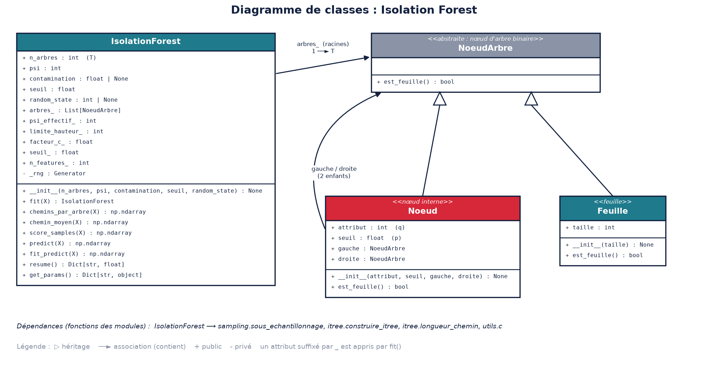

- `IsolationForest` **contient** T racines d'arbres (`arbres_`), de type `NoeudArbre`.
- `Noeud` et `Feuille` **héritent** de `NoeudArbre` ; un `Noeud` **référence** deux `NoeudArbre` (`gauche`, `droite`).
- Les attributs suffixés par `_` sont appris par `fit()`.

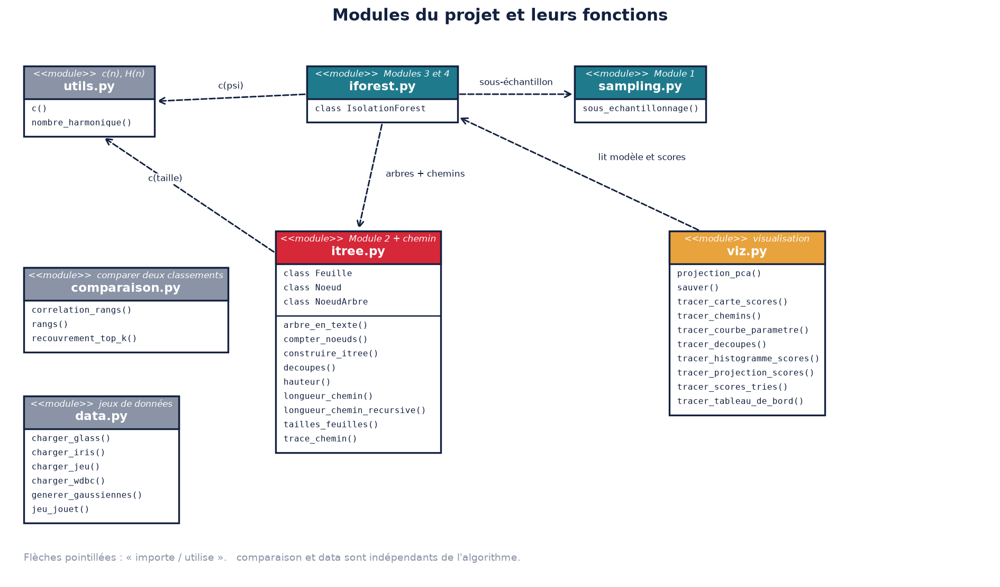

La liste complète des classes, fonctions et méthodes avec leurs signatures est dans `LISTE_DES_METHODES.md`.

## 6. Librairies utilisées

| Librairie | Usage |
|---|---|
| `numpy` | tableaux 2D, tirages aléatoires (`Generator`), calculs vectoriels, SVD pour la PCA |
| `matplotlib` | toutes les visualisations |
| `scikit-learn` | implémentation rapide (`IsolationForest`), comparaison avec notre code, copie de secours d'iris et wdbc |
| bibliothèque standard | `math`, `functools.lru_cache`, `inspect`, `sys`, `os`, `argparse`, `unittest`, `time` |

L'algorithme lui-même (échantillonnage, arbres, forêt, score, comparaison de classements) n'utilise **aucune**
fonction de scikit-learn.

## 7. Résultats et visualisations

Les jeux du prof n'ont pas d'étiquettes : on ne peut donc **pas** calculer d'AUC ni de précision. Les résultats se
lisent comme un classement des points du plus anormal au plus normal. On valide le code de trois façons :
le jeu jouet (calcul à la main), des données synthétiques dont les anomalies sont connues par construction, et
l'accord avec scikit-learn sur les vrais jeux.

### 7.1 Hand-tracing sur le jeu jouet

Jeu de données : A(2, 3), B(3, 2), C(3, 4), D(4, 3), E(3, 3) et l'anomalie F(10, 10).
Hyperparamètres : T = 100, ψ = 6, l = ⌈log₂ 6⌉ = 3, c(6) = 2,9, graine 42.

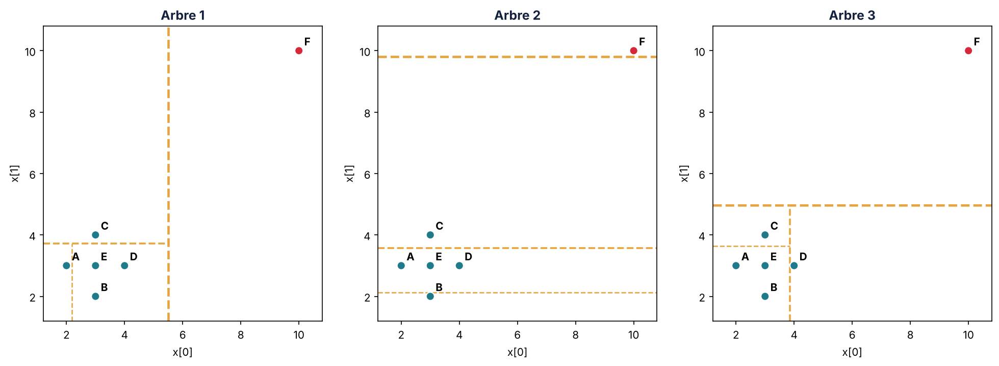

Dans l'arbre 1, F est isolée dès la première coupe (`x < 5,51`) : sa longueur de chemin est 1 + c(1) = 1.
Le point E, au centre du nuage, descend de 3 niveaux et atterrit dans une feuille de taille 3 : 3 + c(3) = 4,667.

| Point | E(h(x)) | Score s(x) | Verdict |
|---|---|---|---|
| A | 3,413 | 0,442 | normal |
| B | 3,387 | 0,445 | normal |
| C | 3,283 | 0,456 | normal |
| D | 3,387 | 0,445 | normal |
| E | 4,500 | 0,341 | normal |
| **F** | **1,400** | **0,716** | **anomalie** |

### 7.2 Jeux du prof (T = 100, ψ = 256, graine 42, seuil = 5 % de points les plus isolés)

| Jeu | n x d | ψ effectif | Seuil | Points déclarés anomalies | Point le plus anormal (indice de ligne, score) |
|---|---|---|---|---|---|
| iris | 150 x 4 | 150 | 0,593 | 8 | ligne 131, s = 0,650 |
| wdbc | 569 x 30 | 256 | 0,537 | 29 | ligne 461, s = 0,676 |
| glass | 214 x 9 | 214 | 0,585 | 11 | ligne 106, s = 0,729 |

Quand n < ψ (iris, glass), le sous-échantillon est le jeu entier : ψ effectif = n. Les sorties complètes (dix points
les plus anormaux, statistiques de la forêt, temps) sont dans `report/resultats_datasets.txt`. Les indices de ligne
commencent à 0.

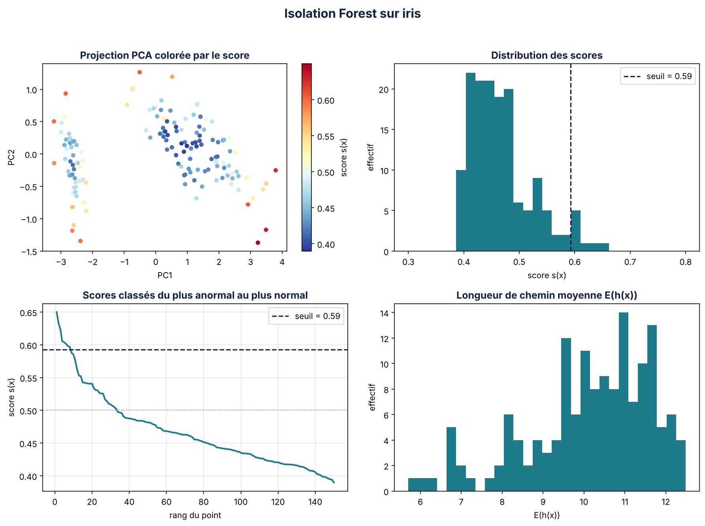

Lecture de la figure iris : sur la projection PCA, les points aux scores les plus élevés (rouge) sont en périphérie du
nuage ; les points au cœur des deux groupes ont les scores les plus bas. L'histogramme de E(h(x)) montre la queue à
gauche : les chemins courts sont les anomalies candidates.

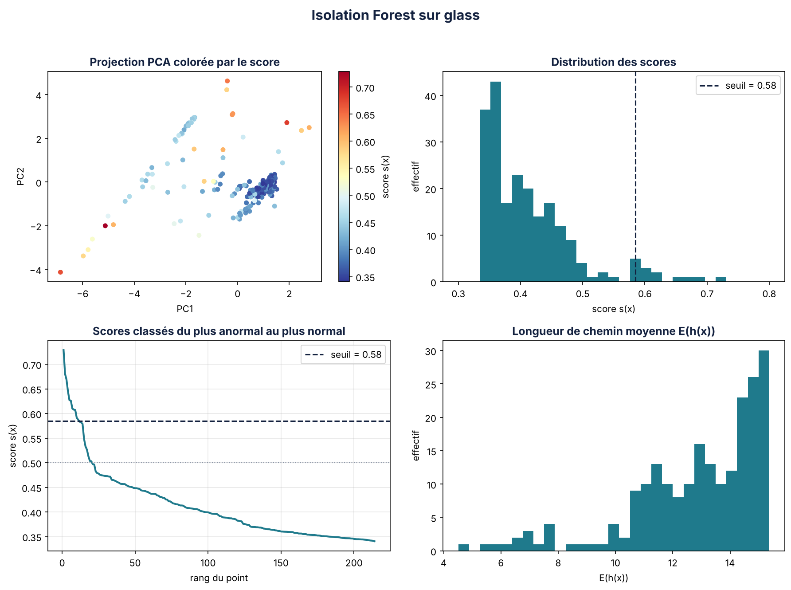

Lecture de la figure glass : la majorité des verres forme un nuage dense en bas à droite (scores bas, bleu), et une
traînée de points dispersés s'en éloigne ; les points les plus isolés (rouge) ont un E(h(x)) bien plus court, et
la courbe des scores triés chute vite : seuls quelques points sont nettement isolables.

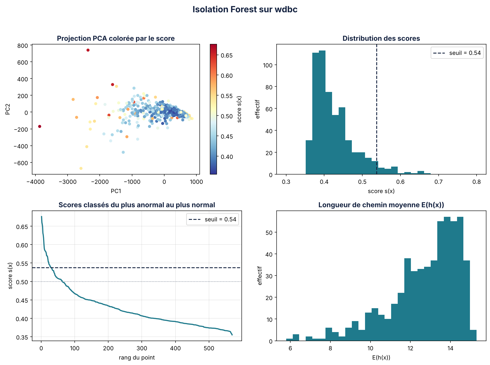

### 7.3 Données synthétiques avec anomalies connues (600 x 2, 30 anomalies injectées)

C'est le seul cas où l'on connaît la vérité : un nuage gaussien (570 points) et 30 points uniformes dans un cube plus
large. La carte montre le score en tout point du plan ; la ligne bleue est le seuil.

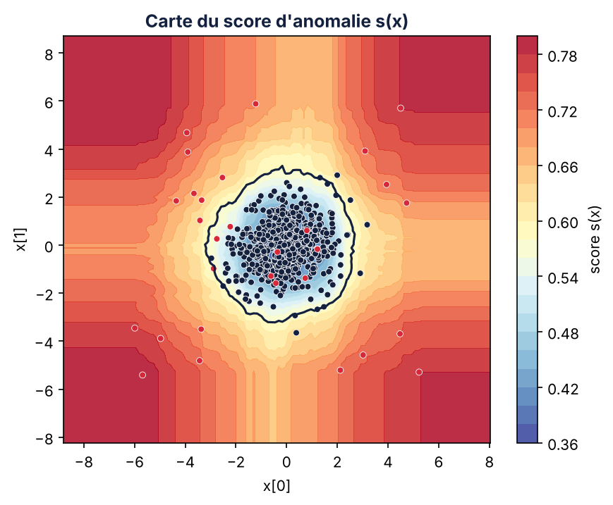
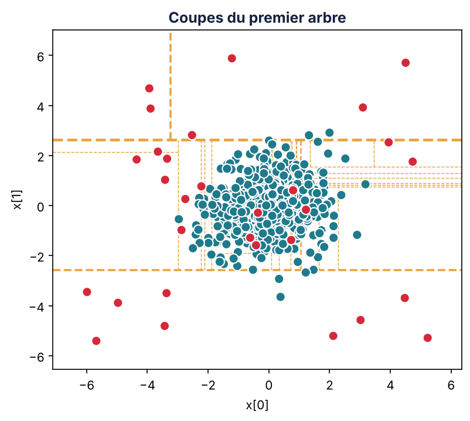

### 7.4 Accord avec scikit-learn (T = 100, ψ = 256, 5 graines)

| Jeu | Corrélation de Spearman des scores | Top-10 des plus anormaux en commun |
|---|---|---|
| iris | 0,969 | 96 % |
| glass | 0,985 | 84 % |
| wdbc | 0,956 | 80 % |

Les deux implémentations classent les points presque de la même façon ; l'écart restant vient du hasard des coupes
(deux graines différentes donnent environ 0,95 entre elles, voir 7.5).

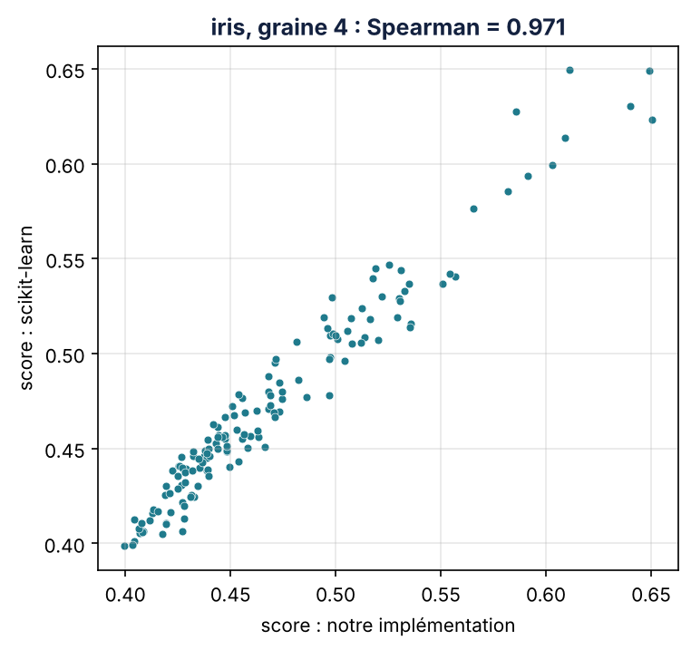

### 7.5 Influence de T et de ψ sur la stabilité

Stabilité = corrélation de Spearman entre les scores de deux forêts de graines différentes (moyenne sur 5 paires ;
psi = 128 pour la première table, T = 100 pour la seconde). Fichier complet : `report/resultats_benchmark.txt`.

| T | 1 | 5 | 10 | 25 | 50 | 100 | 200 |
|---|---|---|---|---|---|---|---|
| iris | 0,18 | 0,56 | 0,71 | 0,85 | 0,92 | 0,96 | 0,98 |
| glass | 0,19 | 0,69 | 0,86 | 0,93 | 0,96 | 0,98 | 0,99 |
| wdbc | 0,19 | 0,57 | 0,68 | 0,84 | 0,91 | 0,96 | 0,98 |

| ψ | 8 | 16 | 32 | 64 | 128 | 256 |
|---|---|---|---|---|---|---|
| iris | 0,91 | 0,87 | 0,93 | 0,96 | 0,96 | 0,96 |
| glass | 0,95 | 0,97 | 0,98 | 0,98 | 0,98 | 0,98 |
| wdbc | 0,86 | 0,93 | 0,95 | 0,95 | 0,96 | 0,96 |

Un arbre seul est très instable ; la forêt moyenne le hasard et le classement se stabilise vers T = 100.
Un petit ψ rend le classement un peu plus sensible au tirage.

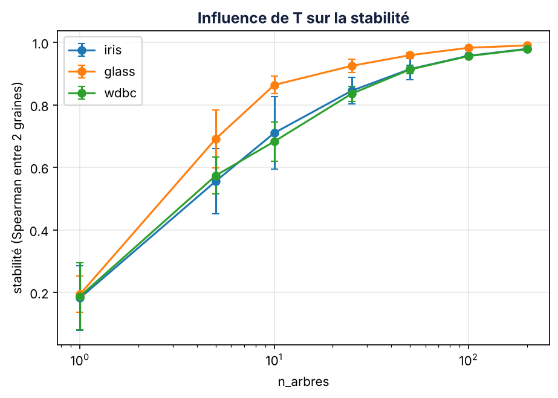
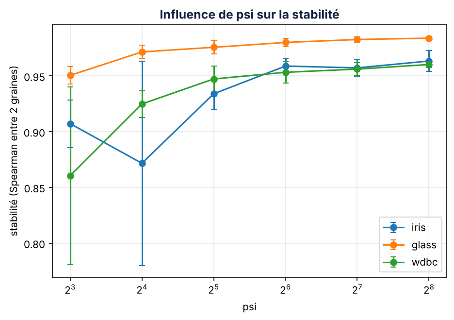

### 7.6 Complexité

Temps de construction pour T = 100 et ψ = 256, avec n de 500 à 32 000 observations : environ 0,04 à 0,06 s dans tous
les cas. Le coût de construction ne dépend pas de n, comme annoncé en diapo 18 (construction ≈ T·ψ·log ψ).

## 8. Tests

66 tests `unittest` (aussi exécutables avec `pytest`) couvrent : `c(n)` et le nombre harmonique, le
sous-échantillonnage (taille, absence de remise, reproductibilité, non-modification de X), la construction
d'arbre (hauteur ≤ l, somme des feuilles = ψ, seuils dans les bornes, arbre binaire strict), la longueur de chemin
(arbre construit à la main, équivalence récursif / itératif), la forêt (formes, plage des scores, reproductibilité,
validation des entrées, taux de contamination), la lecture des fichiers UCI (l'Id, la classe et l'espèce sont bien
écartés), la comparaison de classements, et les figures.

## 9. Limites et pistes d'amélioration

- **Pas de vérité terrain** sur les jeux du prof : on ne peut pas dire combien d'anomalies sont « vraies ». Le seuil
  (5 % ici) est un choix.
- Les coupes sont parallèles aux axes : les anomalies le long d'une diagonale sont plus difficiles à isoler
  (l'*Extended Isolation Forest* utilise des coupes obliques).
- Le scoring est écrit en Python pur (boucles sur les points et les arbres) : correct mais bien plus lent que
  l'implémentation de scikit-learn. Une version vectorisée de la descente dans l'arbre serait la première optimisation.
- Les attributs ne sont pas normalisés : Isolation Forest choisit les seuils entre le min et le max de chaque
  attribut, donc les échelles différentes n'ont pas d'effet sur les coupes.

## 10. Reproduire

```bash
pip install -r requirements.txt
# placer iris.data, glass.data, wdbc.data dans data/
python -m unittest discover -s tests -t . -v
python examples/demo_toy.py
python examples/run_dataset.py wdbc
python examples/compare_sklearn.py
python examples/benchmark.py
python report/reverse_engineering.py
```

Référence : F. T. Liu, K. M. Ting, Z.-H. Zhou, « Isolation Forest », IEEE ICDM, 2008.
